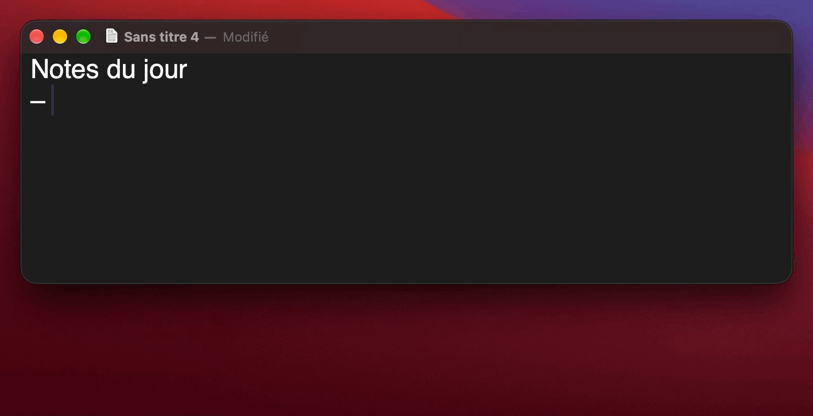

# Dictate

[](https://github.com/moifort/dictate/releases/latest)
[](#get-it)
[](#get-it)
[](LICENSE)

**Hold `control`, speak, release: your words appear wherever you are typing.**

Dictate is push-to-talk dictation for the Mac. It works in any app — mail,
notes, chat, code editor, terminal — and turns what you say into clean,
ready-to-send text.

<p align="center">
  
</p>

## What it does

- **Push-to-talk on `control`** (or `fn`, in Settings). Hold the key while you
  speak, release it when you are done. No window to open, no button to click.
  No waiting either: hold the key again while the last sentence is still being
  cleaned up and keep talking. Sentences land in the order you said them.
- **Text lands at the cursor.** The sentence is typed into whatever field has
  focus. If none does, it waits in the clipboard, ready to paste. In the
  Claude app, Return is pressed for you and the message is sent. Pick the apps
  where that happens, or turn it off, in Settings → Dictation.
- **Clean text, not a raw transcript.** Hesitations ("euh", "um"), repetitions
  and false starts are removed, punctuation and capitals are fixed, misheard
  technical terms are corrected. Your words and meaning stay as you said them.
- **Adapts to where you are.** The tone of the cleanup follows the app: a bit
  more polished in a mail, direct in a chat, raw and technical in a code editor
  or a terminal.
- **Private by design.** Speech is transcribed on your Mac with Parakeet; the
  audio never leaves it. The cleanup is done by Claude Haiku 4.5 through your own
  Claude subscription (it answers without a thinking pass, in about a second) when Claude Code is installed and signed in, or else by Apple Intelligence's
  on-device model, so nothing leaves the Mac. No subscription? Paste an API key
  for Claude, OpenAI (GPT-5.4 nano, no reasoning) or Gemini (3.5 Flash-Lite):
  each runs its fastest model, and the key stays in the keychain. Until you
  pick, Dictate takes the first it finds: Claude, OpenAI, Gemini, then Apple
  Intelligence. Pick another in Settings, or turn the cleanup off entirely. If Claude gets signed out, the pill says so and
  Apple Intelligence steps in; a reply that strays from what you said is
  dropped for the raw transcript. Crashes and errors are reported to Sentry without
  any of your text.
- **Your language, your words.** Pick the dictation language among 25
  European languages and add your own
  vocabulary — names, jargon, product terms — so they come out spelled right.
  The app itself speaks English and French, following your Mac's language;
  the dictation language starts as your Mac's even when the interface falls
  back to English.
- **Discreet.** A small pill at the bottom of the screen shows that Dictate is
  listening, then working, and disappears. While you speak, a spinner beside
  the waves tells that earlier sentences are still on their way. When it
  heard nothing, a crossed-out speaker says so; a press of under a second
  passes silently. It records from the microphone selected in macOS; AirPods
  and other Bluetooth headsets take a couple of seconds to switch to their
  call profile, and the pill only turns to listening once they can hear you.
  Only the microphone is opened, so headphones used just for listening are
  left alone; during a FaceTime or Meet call, macOS keeps the microphone for
  the call and Dictate hears nothing.
- **Your numbers.** A statistics window charts words, dictations, speaking
  pace and the delay before the text appears, by day, week or year. The
  delay chart comes first; when Apple Intelligence stood in for Claude
  during the period, it shows one model at a time, median included. Below
  it, the time you saved: what the same words would have taken to type at
  40 words per minute, less the time spent speaking and waiting.

## Get it

The website, [dictate.polyforms.co](https://dictate.polyforms.co/),
shows what a dictation looks like and links to the latest download.

Download the latest `Dictate-<version>.dmg` from
[Releases](https://github.com/moifort/dictate/releases/latest), open it, drag
Dictate onto Applications and launch it. A short setup walks you through the
permissions. Dictate then keeps itself up to date.

Or, with [Homebrew](https://brew.sh):

```bash
brew install --cask moifort/tap/dictate
```

Requires macOS 27 on Apple Silicon.

## License

Dictate is made by Polyforms and released under the [MIT License](LICENSE).
