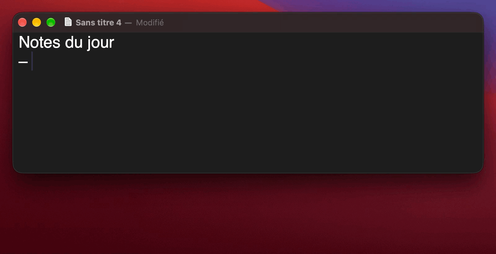

# Dictate

**Hold `fn`, speak, release: your words appear wherever you are typing.**

Dictate is push-to-talk dictation for the Mac. It works in any app — mail,
notes, chat, code editor, terminal — and turns what you say into clean,
ready-to-send text.

  

## What it does

- **Push-to-talk on `fn`.** Hold the key while you speak, release it when you
  are done. No window to open, no button to click.
- **Text lands at the cursor.** The sentence is typed into whatever field has
  focus. If none does, it waits in the clipboard, ready to paste.
- **Clean text, not a raw transcript.** Hesitations ("euh", "um"), repetitions
  and false starts are removed, punctuation and capitals are fixed, misheard
  technical terms are corrected. Your words and meaning stay as you said them.
- **Adapts to where you are.** The tone of the cleanup follows the app: a bit
  more polished in a mail, direct in a chat, raw and technical in a code editor
  or a terminal.
- **Private by design.** Speech is transcribed on your Mac with Whisper; the
  audio never leaves it. Only the text is sent to Claude for the cleanup, through
  your own Claude subscription, and you can turn that off entirely.
- **Your language, your words.** Pick the dictation language and add your own
  vocabulary — names, jargon, product terms — so they come out spelled right.
- **Discreet.** A small pill at the bottom of the screen shows that Dictate is
  listening, then working, and disappears.

## Get it

Download the latest `Dictate-<version>.zip` from
[Releases](https://github.com/moifort/dictate/releases/latest), move
`Dictate.app` to Applications and open it. A short setup walks you through the
permissions. Dictate then keeps itself up to date.

Requires macOS 27 on Apple Silicon.
